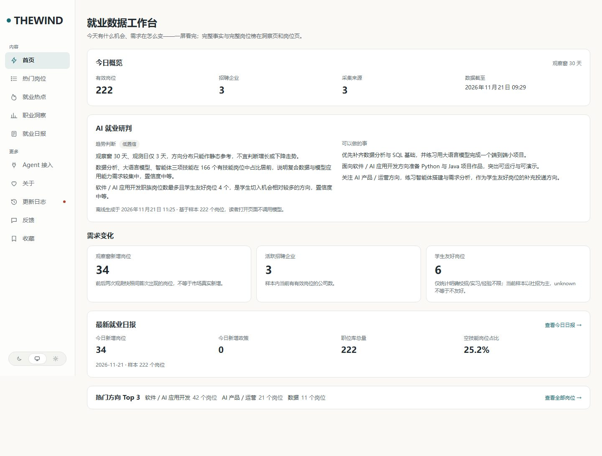
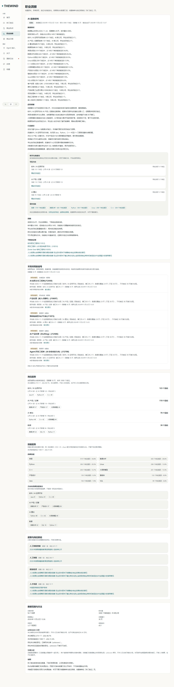
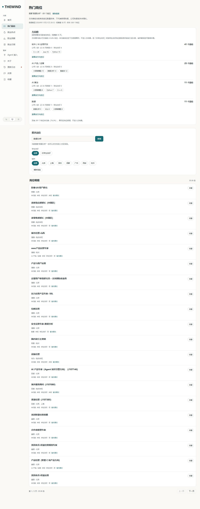
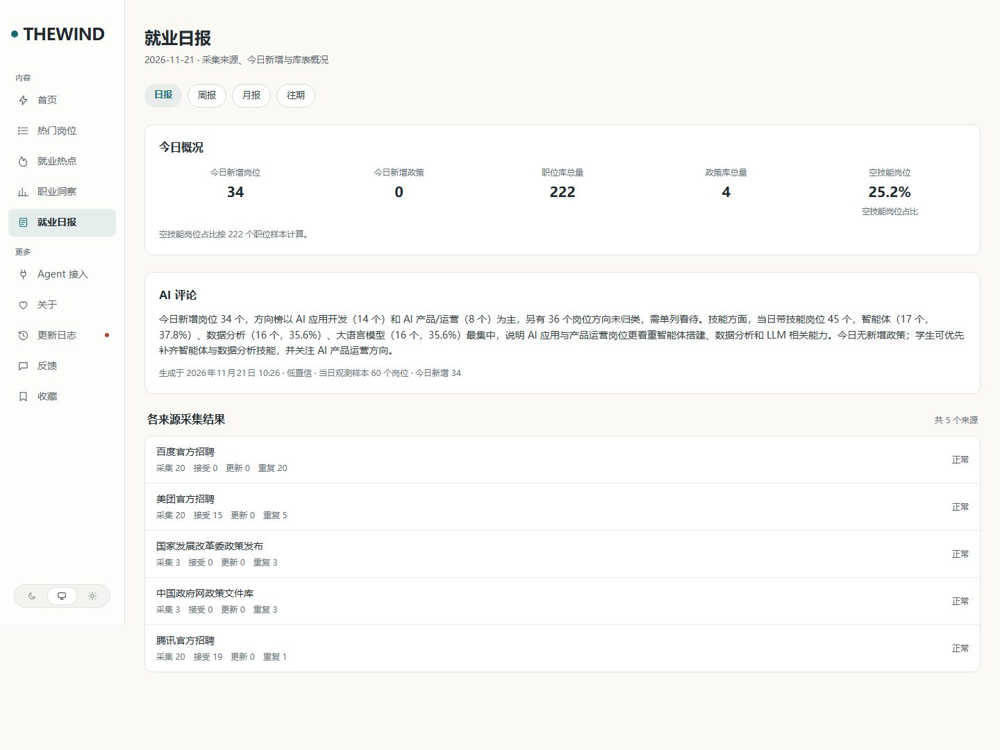
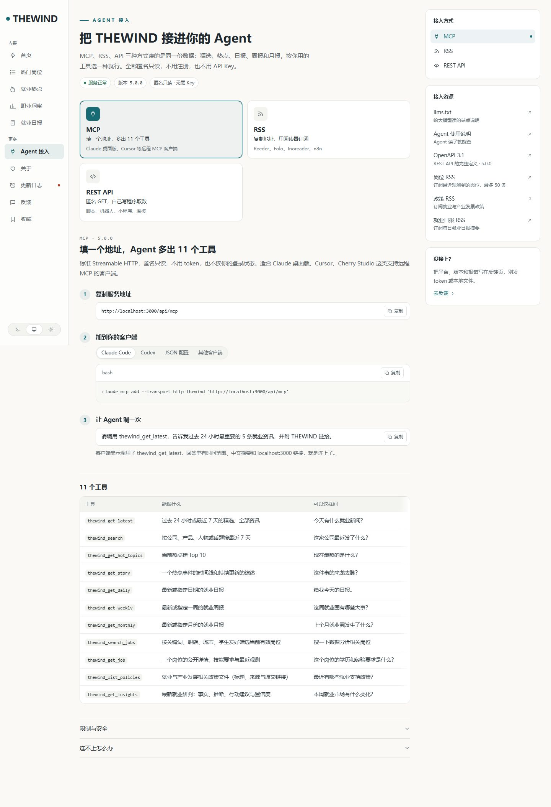
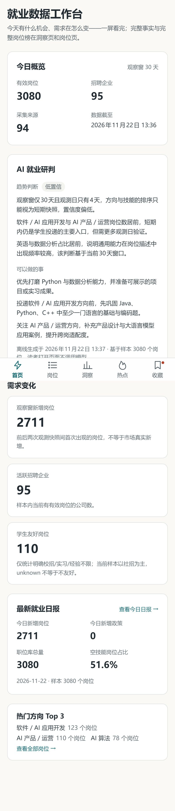
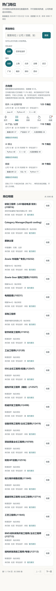
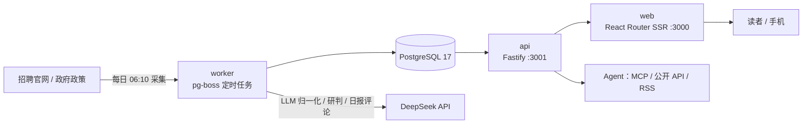

# THEWIND · 就业趋势平台

> 从企业招聘与政府政策公开信息里，自动整理岗位、洞察与每日就业日报的 AI 平台。
> 长沙理工大学「码道」AI 开发者大赛参赛作品（团队：疯狂KEC）。



## 它解决什么问题

招聘信息散落在各家官网，政策文件难读、更新快，学生很难判断"现在哪些方向在招人、要求什么、政策往哪走"。
THEWIND 每天自动采集岗位与政策，做归一化（职族 / 技能 / 学历 / 学生友好度）、聚合出方向与职位趋势、生成 AI 研判与日报评论，让读者在一个页面里看完就业市场。

## 核心功能

- **热门岗位**：方向榜 → 关键词搜索（支持中文技能名，如「数据分析」）→ 城市 / 仅学生友好筛选 → 岗位明细 → 详情（要求、技能、原文、观测记录）。
- **职业洞察**：AI 趋势研判（事实 / 推断 / 行动建议 / 局限 / 置信度）、异常信号（新职族、突增、技能错配）、岗位与技能趋势、政策与岗位联动。
- **就业日报**：今日概况、AI 评论（后台预生成、页面只读缓存）、各来源采集结果；历史日报归档。
- **企业招聘热度榜**、**政策文件**（按就业/产业发展相关性过滤，附原文链接）。
- **收藏**：岗位与文章收藏（浏览器本地，含"可能已下架"探测）。
- **Agent 接入**：站内 `/agent` 提供 MCP（11 个只读工具，`thewind_*`）、公开 API v1（`/api/v1/career/*`，ETag/304）与 RSS（岗位 / 政策 / 日报）。
- **运营后台**：`/admin/career` 查看采集、来源健康、LLM 兜底、研判/评论状态；模型步骤可切换。
- **移动端适配**：44px 触控目标、搜索首屏、详情吸顶栏、安全区、PWA manifest。

<table>
  <tr>
    <td></td>
    <td></td>
  </tr>
  <tr>
    <td></td>
    <td></td>
  </tr>
  <tr>
    <td></td>
    <td></td>
  </tr>
</table>

更多截图见 [`docs/screenshots`](docs/screenshots)。

## 架构



- **web**：React Router 8 SSR，SEO（meta / JSON-LD / sitemap）、RSS 发现、移动端壳层；
- **api**：Fastify，站点只读 API、公开 v1 API、MCP、后台接口；
- **worker**：pg-boss，单条串行管线（采集 → LLM 兜底 → 研判 → 日报评论）+ 保留清理 / 索引 / 备份 / 推送；
- **db**：PostgreSQL 17，迁移 + seed；
- 同一镜像跑四种角色（setup / api / worker / web）。

## 本地运行

需要 Node 24 与 Docker。

```bash
cp .env.example .env          # 填 DATABASE_URL / LLM_* / ADMIN_PASSWORD / SESSION_SECRET 等
docker compose up -d --build  # 打开 http://localhost:3000

# 可选：导入 2026-11-21 演示数据快照（369 岗位 / 10 政策 / 已生成的研判与日报评论）
docker compose exec -T db psql -U aihot -d aihot < database/demo/demo-data.sql
```

> **无需 API Key 即可浏览完整页面**：演示数据里已包含岗位、政策与 AI 研判/日报评论的预生成缓存，页面只读缓存；只有重新采集或重新生成 AI 内容时才需要在 `.env` 配置 `LLM_*`。

`--profile https` 可启用 Caddy 自动 HTTPS（设置 `SITE_DOMAIN`、`SITE_URL`）。

首次部署会自动执行数据库迁移与 seed；采集与就业日报每天默认 06:10（北京时间）运行。

## 数据来源与口径

- **岗位（33 个来源）**：腾讯、美团、百度、华为、网易、滴滴、荣耀、中国建筑、科大讯飞、大华股份、汇川技术、欣旺达、京东方、中科曙光、新华三、迈瑞医疗、联影医疗、英威腾、三一重工、启明星辰、信捷电气、石头科技、追觅科技、瑞声科技、拓荆科技、新松机器人、埃夫特、禾望电气、首航新能源、德业股份、集创北方、金升阳、宇树科技的官方招聘页（公开页面，附官方原文链接）；
- **政策（7 个来源）**：中国政府网、国家发改委、教育部、人社部「中国就业网」、长沙市人社局、湖南省教育厅、湖南省人社厅「通知公告」的公开政策文件，按「就业 + 产业发展」相关性规则过滤后展示；
- 科大讯飞、大华股份、汇川技术、欣旺达、京东方、中科曙光、新华三、迈瑞医疗、联影医疗、英威腾、三一重工、启明星辰、信捷电气、石头科技、追觅科技、瑞声科技、拓荆科技、新松机器人、埃夫特、禾望电气、首航新能源、德业股份、集创北方、金升阳、宇树科技共 25 家企业的岗位来自其 zhiye 招聘平台的公开职位列表接口，以各企业官方职位列表页（`https://<tenant>.zhiye.com/social/jobs`，如 <https://iflytek.zhiye.com/social/jobs>）为原文入口；其中英威腾、三一重工的官方列表接口分页不生效，仅首屏有效；
- 所有页面均以原文链接为准；职族/技能为规则 + LLM 归一化结果，未识别的单列为「未归类」，不强行归类；
- AI 生成的研判与日报评论为后台预生成缓存，页面标注置信度与数据截止时间；
- 当前库：**369 个岗位 / 659 条观测 / 10 条政策**；信源仍在持续扩展（比赛周期内先打通完整链路，后续会加更多企业、部委与地方政策源，并积累更长观测历史）。

## AI 协作开发

本作品使用**华为云码道**作为主要 AI 开发工具（规格、实现、评审、联调），
在码道额度用尽后用 **DSH（DeepSeek Harness）多代理协作**完成收尾：P0/P1/P2 功能补齐、THEWIND 品牌改名、
手机端适配、安全/数据口径/SEO 深度 debug 与 CI 修复。详细记录见提交包中「AI 辅助创作证明」。

## 许可证与致谢

- 代码以 **MIT License** 发布，见 [LICENSE](LICENSE)。
- 本项目基于开源框架 **AIHOT**（Copyright © 2026 数字生命卡兹克, MIT）二次开发；上游名称与 Logo 不在 MIT 许可内，
  本项目已更名为 THEWIND，保留上游版权声明，见 [NOTICE](NOTICE) 与 [CREDITS.md](CREDITS.md)。
- 第三方数据版权归各来源方所有，本项目仅做公开信息聚合与链接引用。
